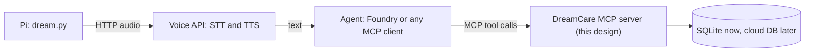

# Design: DreamCare MCP server

Status: **approved** (2026-10-19). Steps 1 to 4 are built; see PROGRESS.md.

## Goal

Rebuild the medication part of the backend as a real **Model Context Protocol (MCP) server** that I write myself, test-first, so that an AI agent (Azure AI Foundry, or any MCP client) can answer "what medication is due now?" and record "I took it".

The old team backend called itself "MCP" (*Multi-Channel Processor*). This is a new, separate component; the old backend stays as reference only.

## What MCP is (and is not) here

MCP is a standard way to give an AI model **tools**. The model decides when to call a tool; the MCP server runs it and returns the result.

The Raspberry Pi does **not** speak MCP. It keeps sending audio over plain HTTP to a voice API. Only the agent talks to the MCP server.



## Tools

Three small tools. Each one does one thing, and returns plain JSON the model can read.

| Tool | Input | Output | Notes |
|---|---|---|---|
| `get_due_medications` | `window_minutes` (int, default 15, max 120) | list of `{medication_id, name, dose, instructions, scheduled_time}` | Uses the server's clock and the user's time zone. Handles windows that cross midnight. |
| `list_medications` | `include_inactive` (bool, default false) | list of `{medication_id, name, dose, instructions, days, time, active, start_date, end_date}` | |
| `confirm_intake` | `medication_id` (int), `status` (`taken` / `missed` / `unclear`) | `{recorded: true, intake_id, recorded_at}` | **Actually writes to the database** (the old backend only said it did). |

### Why the tools take no `user_id`

The device belongs to one person. If the model could pass any `user_id`, a confused or manipulated prompt could read someone else's medications. Instead, the server knows its user from configuration (`DREAMCARE_USER_ID`), and later from authentication. The model can only ever see this user's data.

### Errors

Tools never hide failures. A database error returns a clear MCP error, not an empty list. (The old `get_due_meds` returned `[]` on errors, so "database down" looked like "nothing due", which is dangerous for medication.)

## Data model (SQLite)

Based on the old Azure SQL tables, with English names and one new table.

```sql
CREATE TABLE users (
    user_id    INTEGER PRIMARY KEY,
    name       TEXT NOT NULL,
    time_zone  TEXT NOT NULL DEFAULT 'America/Costa_Rica'
);

CREATE TABLE medications (
    medication_id INTEGER PRIMARY KEY,
    user_id       INTEGER NOT NULL REFERENCES users(user_id),
    name          TEXT NOT NULL,
    dose          TEXT,
    instructions  TEXT,
    days          TEXT NOT NULL,          -- e.g. 'mon,tue,wed,thu,fri,sat,sun'
    time          TEXT NOT NULL,          -- 'HH:MM', local time
    start_date    TEXT,                   -- 'YYYY-MM-DD' or NULL
    end_date      TEXT,                   -- 'YYYY-MM-DD' or NULL
    active        INTEGER NOT NULL DEFAULT 1
);

-- New: the old backend never stored confirmations
CREATE TABLE intake_log (
    intake_id     INTEGER PRIMARY KEY,
    medication_id INTEGER NOT NULL REFERENCES medications(medication_id),
    status        TEXT NOT NULL CHECK (status IN ('taken', 'missed', 'unclear')),
    recorded_at   TEXT NOT NULL           -- ISO 8601, UTC
);
```

Why SQLite: free, no server, and every test can create a fresh database in memory. The data access sits behind one small module, so a cloud database can replace it later without touching the tools.

## Code layout

```
server/
  dreamcare_mcp/          # NOT named "mcp": that would hide the official mcp SDK package
    __init__.py
    schedule.py           # pure logic: which medications are due (no database, no clock)
    repository.py         # SQLite access
    server.py             # MCPServer: defines the three tools
  tests/
    test_schedule.py
    test_repository.py
    test_tools.py
  pyproject.toml
```

The most important rule: **`schedule.py` is pure.** It receives the medications and the current time as arguments. That makes the trickiest logic (days of week, date ranges, midnight) easy to test with no database and no real clock.

Built with the official Python MCP SDK (`mcp` 2.x, `MCPServer`; in 1.x this class was called `FastMCP`).

## Testing plan (pytest)

- **`schedule.py`:** due inside the window, just outside it, window crossing midnight, wrong weekday, before `start_date`, after `end_date`, inactive medication, time zone conversion.
- **`repository.py`:** uses an in-memory SQLite database created by a pytest **fixture**; checks that `confirm_intake` really inserts a row.
- **Tools:** call the tools through the MCP SDK's in-memory client, with a fixed clock, and check the JSON they return, including error cases.
- **CI:** a GitHub Actions workflow runs all tests on every push and pull request.

## Steps (each one small, working, and committed)

1. Project skeleton: `pyproject.toml`, empty package, one passing test, GitHub Actions CI.
2. `schedule.py`, test-first.
3. `repository.py` with the SQLite schema and a seed script with demo data (fictional patient).
4. `server.py` with the three tools; try them locally with MCP Inspector (free).
5. Evaluation set: example questions with the expected tool calls.
6. Later, with cost approval: host it with HTTPS and authentication, and connect an Azure AI Foundry agent.

## Cost

Steps 1 to 5 are free and run on my laptop. Step 6 uses Azure (hosting plus model calls); I will check my credit and approve it before anything is created.

## Open questions

- ~~Spanish or English tool output?~~ Decided: field names in English, medication text as stored.
- ~~Hide doses already confirmed as `taken`?~~ Decided: yes. A dose is hidden when a `taken` intake was recorded at or after the start of its window; `missed` and `unclear` do not hide it.
- Where should Step 6 host the server: Azure Container Apps or Azure Functions? Decide later, after checking the current Microsoft templates and pricing.
